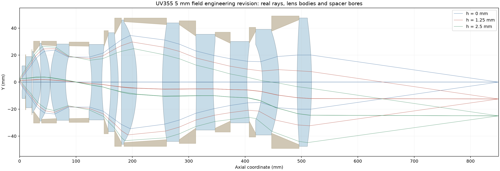
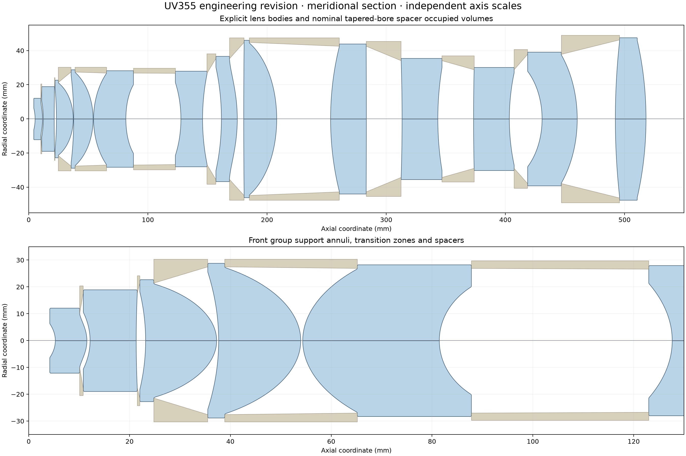
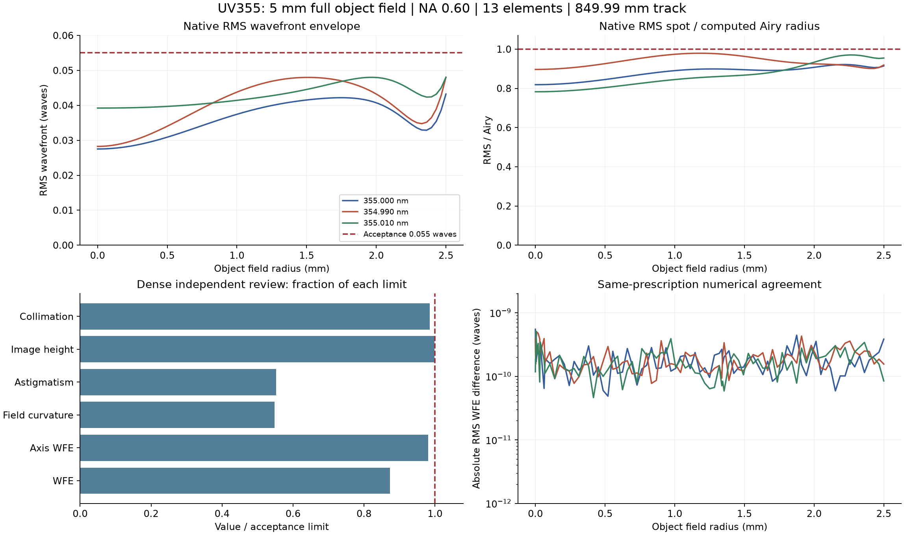
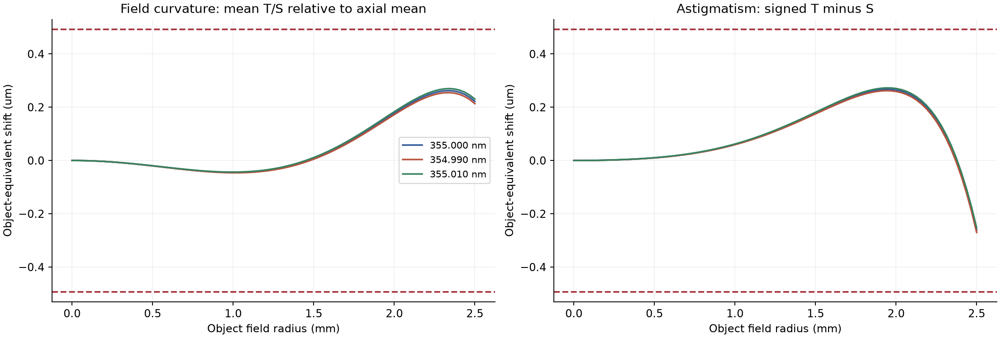
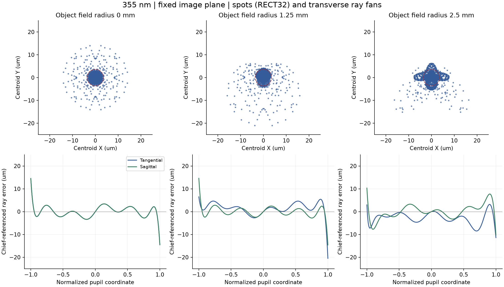

# UV355 物镜：5 mm 视场最终设计

当前推荐结果为 **5 mm 最终 F 余量版**：物方全视场直径 5 mm、NA 0.60、名义倍率 −10×，13 片镜片（前／中／后组为 5／3／5 片），光学总长 849.99 mm。处方包含四个偶次非球面，实际波长为 354.990、355.000 和 355.010 nm，沿用项目五通道权重。

- [下载 Zemax 最终处方](UV355_5mm_final/UV355_13ELEMENT_849p99_5MM_ENGINEERING.zmx) · [5 mm 版本说明](UV355_5mm_final/README.md)
- [5 mm 案例：图表与验证范围](https://github.com/wufansaber/standalone-optics/tree/main/examples/uv355-5mm)
- 处方 SHA-256：`049e5b39a476154eafe5b75a28b519f2ae7f863195c3af1ecc463c954ed5a055`

### 主要像质结果

| 指标 | 5 mm F 版复核最坏值 | 项目要求 |
|---|---:|---:|
| RMS 波前 | 0.04803799 λ | ≤ 0.055 λ |
| 轴上 RMS 波前 | 0.03922212 λ | ≤ 0.040 λ |
| RMS / Airy | 0.979165 | ≤ 1 |
| 物方场曲 | 0.269903 µm | ≤ 0.493 µm |
| 物方像散 | 0.272529 µm | ≤ 0.493 µm |
| 像高误差 | 14.976003 µm | < 15 µm |
| 前组准直偏离 | 0.985241 mrad | ≤ 1 mrad |
| 正弦误差 | 99.714034 µm | ≤ 100 µm |

同处方进行了独立 689 个视场点复核，以及 Zemax 244 个视场点的波前与光斑复核和 9,408 条边缘瞳光线通光检查。以上为离散采样结果，并非连续视场的数学证明。MTF 由使用者根据曲线判断，不设数值验收门槛。

名义光学、显式镜片实体及隔圈方案已复核；净工作距离 4.150 mm，全径最小空气净距 0.400 mm，隔圈通光采样最小径向余量 0.945328 mm。ZMX 用于通光口径内的光学追迹，不能单独完整表达非工作区过渡、支承和隔圈实体。供应商工艺确认、完整公差良率、装配和热验证及最终制造放行仍待完成。

## 光路与镜片结构

蓝色表示镜片实体，棕色表示隔圈包络；光线对应三个物高。横纵坐标按图示分别缩放，属于计算示意图。

## 像质与像差

上排取各波长和物高下所采样条件的最坏值；图中的数值差是同处方计算结果的差异，不代表实物测量不确定度。

场曲为 T/S 平均焦面相对同波长轴上平均焦面的偏移；像散为 T、S 焦面间距，均按倍率平方换算为物方等效量。

点列图与扇形图对应 355 nm、同一固定像面；点列相对质心，虚线圆表示计算 Airy 半径，扇形图相对主光线。

更多采样说明、数据和工程边界见 [5 mm 案例](https://github.com/wufansaber/standalone-optics/tree/main/examples/uv355-5mm)。优化经验见 [跨项目复用指南](光学优化方法_跨项目复用指南.md) 和 [高效约束优化方法](光学镜头高效约束优化_可复用方法详解.md)。
