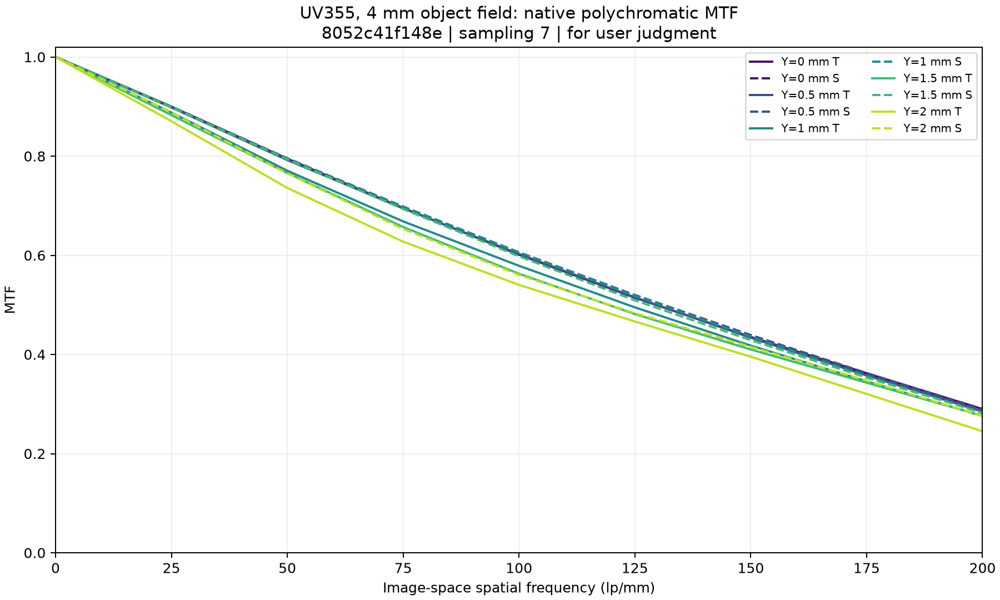
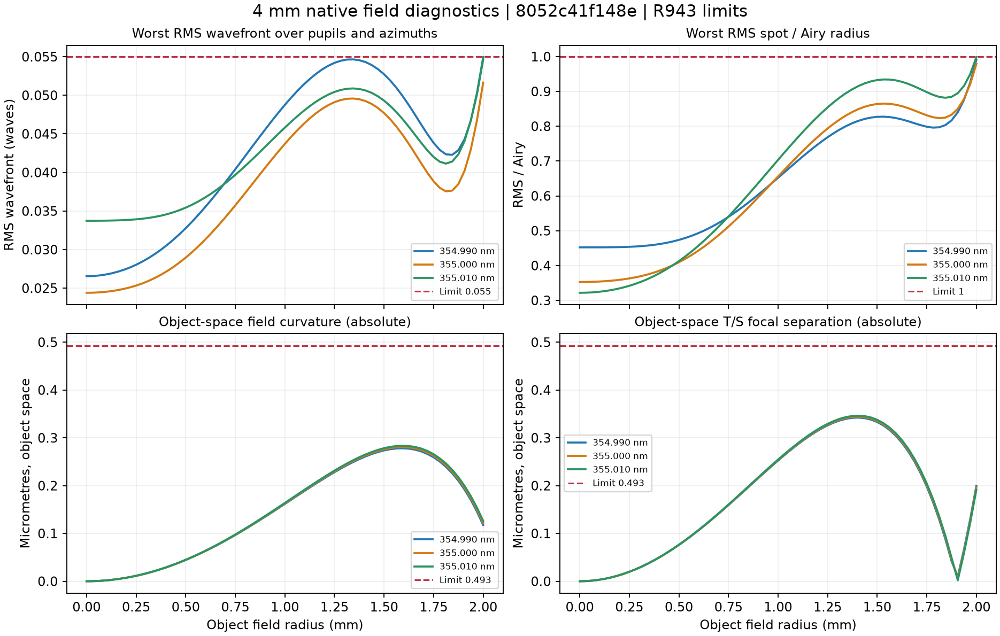

# 4 mm设计数值检查结果

处方 SHA256：`8052c41f148e285af8521eb922b8bde728ec758d09006b8c9f5721f8dd708366`。物方视场直径4 mm，NA 0.60，名义倍率−10×。

129、513、1025点原生复核均通过现行数值要求。MTF只提供曲线，由用户判断。

[Zemax处方](prescription.zmx) · [原始评价函数](prescription.MF) · [处方参数](PRESCRIPTION_PARAMETERS.json)

| 项目 | 复核最坏值 | 要求 |
|---|---:|---:|
| RMS波前 | 0.054949822 λ | ≤0.055 λ |
| 轴上RMS波前 | 0.033733907 λ | ≤0.04 λ |
| RMS/Airy | 0.998516989 | ≤1 |
| 物方场曲 | 0.283411 µm | ≤0.493 µm |
| 物方像散 | 0.346289 µm | ≤0.493 µm |
| 像高误差 | 14.962812 µm | <15 µm |
| 前组发散 | 0.999946629 mrad | ≤1 mrad |
| 物方主光线角 | 0.018149505° | ≤0.02° |
| 像方主光线角 | 0.072959041° | ≤0.08° |
| 工作距离 | 4.346935 mm | >4 mm |
| 总长 | 899.999995135 mm | ≤900 mm |

85个原始变量及8794行评价函数保持一致，实体厚度和间隙检查通过。大口径厚度按用户授权推算规则检查。场曲按同波长轴上平均焦面为参考，像散为T/S焦面全间距，均使用实际波长倍率平方换算到物方。

原始审计文件保留其历史0.05 λ检查结果；现行0.055 λ及场曲、像散要求的判定单独存放于[当前验收汇总](ACCEPTANCE_SUMMARY.json)，未覆盖历史原始数据。

MTF采用原五波长多色计算，采样7稳定，频率为像方lp/mm。

原始20轮成功内部迭代、4次无改善重启、扩大搜索域及色差稳定性证据尚未建立；本次有限修复不计作这些停止条件。制造公差、装调和最终放行尚未完成。采样通过不等于连续视场数学证明。

继续设计应从本处方启动；保留全量几何约束，先验证基线，再进行有余量的优化。不得恢复MTF自动门槛或使用按正负号动态筛选几何约束的旧路线。
