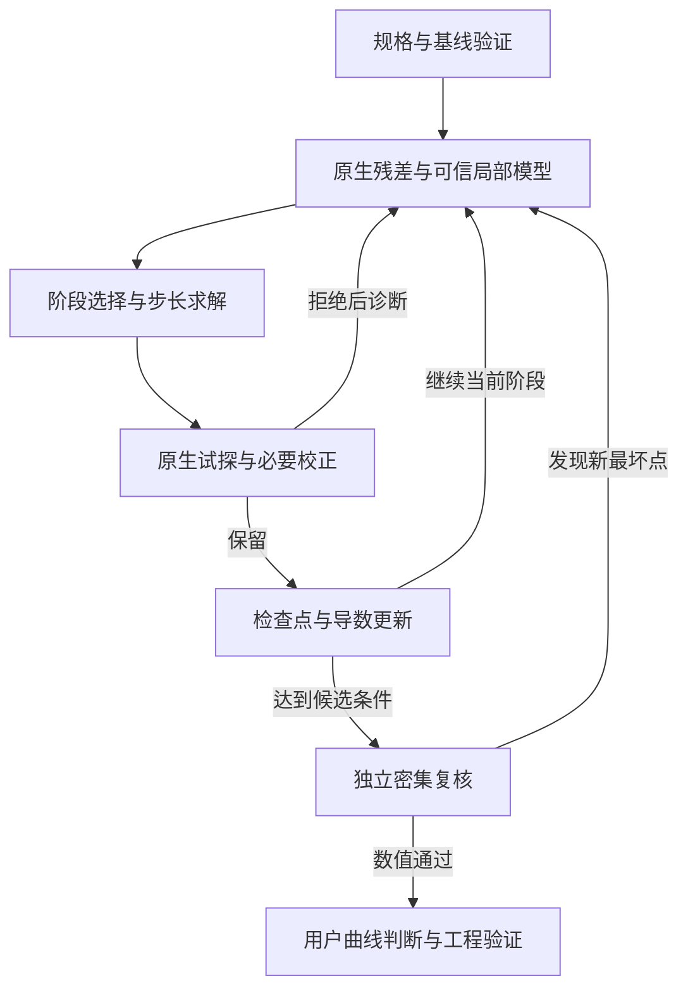

# 光学镜头高效约束优化：可复用方法详解

更新日期：2026-11-04。本文面向光学设计人员与优化程序开发人员。

本文将 UV355 物镜从小视场扩展到 4 mm、并将总长从约 900 mm 缩短到 849.99 mm 的工作，整理为可迁移的方法。正文按照最终采用的方法组织；具体轮次与中间修改不作为操作流程。

**核心方法：先建立可实现的光学架构，保留原生光线的有符号残差，用可信的局部模型提出步长；对边界做校正，在收尾阶段优先完成可行性和余量，再以独立采样验证。**

已有的[跨项目复用指南](光学优化方法_跨项目复用指南.md)侧重设计流程；本文进一步说明数学模型、实现接口、失败诊断与迁移办法。机器可读的案例依据见[方法与验证证据](docs/UV355_COMPACT850_METHOD_EVIDENCE.json)。

## 阅读路径

- 设计负责人：重点阅读第 1—4、12、15—18 节。
- 优化程序开发者：重点阅读第 5—14、19 节。
- 新项目启动：使用第 16 节的配置模板、第 17 节的实施顺序。
- 判断本方法是否值得采用：先看第 1、13、20 节中的证据与适用边界。

## 1. 已验证的结果与结论范围

### 1.1 最终案例

本例为近 355 nm、物方 NA 0.60、物方圆视场直径 4 mm、名义倍率 −10× 的系统。以下为同一最终处方的独立复核结果，并非优化工作采样中较低的那个数值。

| 指标 | 最终复核结果 | 本项目正式要求 |
|---|---:|---:|
| 总长 | 849.99 mm | ≤850 mm |
| 最坏 RMS 波前 | 0.054629852 λ | ≤0.055 λ |
| 轴上最坏 RMS 波前 | 0.037417127 λ | ≤0.04 λ |
| 最坏 RMS 光斑／Airy 半径 | 0.989080068 | ≤1 |
| 物方场曲 | 0.272760 µm | ≤0.493 µm |
| 物方像散 | 0.317108 µm | ≤0.493 µm |
| 最大像高误差 | 14.949735 µm | <15 µm |
| 前组发散角 | 0.999565956 mrad | ≤1 mrad |
| 物方主光线角 | 0.019979375° | ≤0.02° |
| 像方主光线角 | 0.079959847° | ≤0.08° |
| 固定尺度正弦映射误差 | 99.950002 µm | ≤100 µm |

129、513、1025 视场点的独立检查、极近轴严格排序、三档密集正弦检查和实体几何检查均通过。MTF 按原生多色曲线提供，采样 6→7 的最大变化为 2.4382×10⁻⁵，供用户目视判断。

处方 SHA256：

```text
0228a6b1501e513d200872afe53369952357efecb6ac91207353ab3fcefe6d42
```

这些证据对应**已检查采样范围的数值通过**。本例没有建立连续域的数学证明、全局最优证明、制造装调良率或完整工程放行证据；原约定的全部优化停止证据也不应由一次数值通过代替。MTF 的用户判断仍单独保留。

### 1.2 哪些效率改善有直接证据

| 对照 | 可核对的结果 | 结论边界 |
|---|---|---|
| 同处方、同信赖域的局部步长对照 | 标量线性模型使用 7 次原生评价、32.094 s；范数曲率模型使用 3 次、14.312 s；固定口径目标降幅分别为 0.01684 与 0.13993 | 单一起点的局部对照；共享导数建立成本未计入 |
| 同处方的完整／压缩锥模型 | 求解时间 14.687→3.922 s，约 3.74 倍；步长差范数 1.55×10⁻⁶ | 仅为子问题求解加速；该对照中两个名义整步都未通过机械检查，均未保留 |
| 原生有符号波前向量重建 | 正确参考投影下，99 组 GQ RMS 的最大差约 6.18×10⁻⁹ λ | 是指定版本、处方和采样的等价性检查，不保证其他配置自动等价 |
| 同一口径的整个缩短任务目标 | 5.39038879→0.03024982 | 自定义统一约束评价函数的改善；不是原始 8794 行 MF 数值，也不是整体耗时倍数 |

最终收尾采用了不同的可行性权重和额外设计余量，另存阶段评分。**不能把换权重后的阶段分数接到原评分曲线上，声称评价函数突然下降。**

没有进行覆盖所有方法、所有结构和多个随机起点的完整消融试验。因此可以说这套组合在本案例有效，不能宣称其对所有镜头都最快。

## 2. 优化效率来自四层，而不只来自求解器

| 层次 | 需要解决的问题 | 对效率的影响 |
|---|---|---|
| 光学架构 | 光焦度、光阑、共轭、NA、视场、机械包络是否相容 | 决定可行解是否存在于当前结构附近 |
| 数学表达 | 变量、残差、约束和余量是否表达了真实物理变化 | 决定局部模型能否提出有效步长 |
| 数值执行 | 导数、缓存、分块、低秩求解和校正是否高效 | 决定每个有效步长需要多少时间 |
| 验证闭环 | 最坏点是否被遗漏，结果能否复现 | 决定省下的时间会不会变成返工 |

DLS 本身属于阻尼 Gauss–Newton 一类方法。本项目的改进重点是残差表示、约束模型、坐标尺度和验证闭环；仅更换算法名称并不能得到同样结果。

建议优化的实际时间预算为：

$$
T_{\mathrm{total}}=T_{\mathrm{initialization}}+T_{\mathrm{derivatives}}+
T_{\mathrm{subproblems}}+T_{\mathrm{trials}}+T_{\mathrm{independent\ review}}.
$$

每轮耗时下降但原生回退次数增加，可能使总耗时更长。评价算法时，应同时记录建立导数的成本、接受步数量、真实约束违反量、最终独立复核结果和总墙钟时间。

## 3. 先统一规格、优化目标与验证口径

### 3.1 四类量分别管理

| 类别 | 示例 | 使用方式 |
|---|---|---|
| 正式硬条件 | 波前上限、像高、远心角、最薄处、总长 | 按正式定义逐项检查 |
| 软质量目标 | 平均像质、色差趋势、参数敏感度 | 在允许方向中改善，权重和单位公开 |
| 优化内部余量 | 波前比上限更低、间隙略大、近轴趋势为正 | 用于搜索；不修改正式验收要求 |
| 诊断量 | 分组像差、Petzval 和、主平面位置、MTF 曲线 | 用于分析；是否验收由项目另行确定 |

每个指标都应附带：物理定义、单位、参考面、波长与权重、场点、瞳面采样、最坏值或平均值规则、允许值以及失败追迹的处理方式。

例如，“场曲”可能指旁轴焦面，也可能指加权实光线最佳焦面。本例采用 T/S 平均焦面相对同波长轴上平均焦面的物方偏移；像散采用 T/S 焦面间距。其他项目必须重新定义，不能仅复制数值。[OpticStudio 场曲定义](https://ansyshelp.ansys.com/public/Views/Secured/Zemax/v252/en/OpticStudio_User_Guide/OpticStudio_Help/topics/Field_Curvature_and_Distortion.html)可用于核对软件分析量的含义。

### 3.2 用有符号余量统一约束

设越小越好的指标为 $q_i(x)$、正式限值为 $L_i$：

$$
g_i(x)=\frac{L_i-q_i(x)}{s_i},\qquad g_i(x)\ge0.
$$

其中 $s_i>0$ 是数值归一化尺度。可以取 $L_i$，也可以取有物理意义的允许变化尺度；必须记录选择。双边条件分成两条不等式，等式单独管理。

最坏违反量可定义为：

$$
v(x)=\max_i\{0,-g_i(x)\}.
$$

正式阈值、数值求解容差、搜索余量和制造公差分别存储。求解器返回 `Solved` 只说明局部子问题的数值状态。

本例 MTF 由用户看曲线判断，所以没有加入 MTF 硬约束。其他镜头若规定具体频率、方向和场点的 MTF 门槛，就应将该要求显式建模。

## 4. 从光学结构上创造可行方向

### 4.1 联合考虑光焦度、主平面与共轭

缩短总长时，应同时检查组焦距、主平面位置、共轭距离、光阑位置、工作距离和实际成像倍率。只缩空气间隔容易把困难转成离焦、远心误差或通光问题。

在空气中，以光线向量 $(y,n\theta)$ 表示的组矩阵为：

$$
M=\begin{bmatrix}A&B\\C&D\end{bmatrix},\quad
f=-1/C,\quad \mathrm{BFL}=-A/C=fA.
$$

以上焦距式针对组两端为空气且采用相应符号约定的情况；浸没系统应使用对应折射率的公式。折射面的传播矩阵和符号约定必须一致。

即使 $f$ 的变化不大，$A$ 和主平面位置的变化也能明显改变后焦距。在准直中继近似成立时，倍率与前后有效焦距之比相关，重新分配光焦度时仍需保护实际倍率。

| 本例组参数 | 约 900 mm 基线 | 849.99 mm 方案 |
|---|---:|---:|
| 前组焦距 | 30.74955 mm | 30.72877 mm |
| 前中组合焦距 | 49.92222 mm | 47.96685 mm |
| 后组成像组焦距 | 498.42920 mm | 479.52621 mm |
| 后组／前中组焦距比 | 约 9.9841 | 约 9.9970 |

本例释放了前中组合约 50 mm 的旧限制，联合调整各组光焦度和共轭关系，总长缩短约 50.01 mm。不能从这一个结果推导“改变焦距比就一定能缩短任意系统”；实际倍率、NA 和接口必须同时复核。

### 4.2 根据像差分工选择自由度

- 球差与高阶球差：检查高光线高度处的光焦度、镜片弯曲及非球面校正效率。
- 彗差与远心：检查光阑、主光线与各组光束位置。
- 场曲与像散：检查组间光焦度分担、Petzval 趋势和实光线 T/S 焦面。
- 色差：检查材料与光焦度搭配，以及光谱范围内的实际折射率。
- 大口径实体问题：检查矢高、最薄处、间隙极值及实际通光包络。

这些是结构诊断线索。高 NA 时，三阶指标适合初筛，最后需要完整系统的实光线结果。

### 4.3 用延拓减少无效重启

从已验证起点出发，对视场、NA、波段或总长选择一个主要延拓参数，逐步逼近最终要求。每一步识别新的主导约束，再决定释放哪些自由度。

遇到停滞时，先区分局部模型失准、尺度失衡、边界曲率与结构自由度不足，再决定是否换结构。离散材料、镜片数量和镜头型式可用少量结构候选比较；不必把所有原始系数都交给大规模随机搜索。

## 5. 让坐标代表可理解的物理变化

### 5.1 物理尺度归一化

写成 $x=x_0+Sz$，让一个单位的 $z_j$ 对应有意义的曲率、厚度或面型变化。原始数值大小接近，不代表它们对光学系统的影响接近。

本例厚度方向使用约 1 mm 的搜索单位，非球面正交矢高方向使用约 1 µm 的单位。它们只是本项目的坐标尺度，不是差分步长、允许公差或新项目推荐值。

先检查物理尺度，再观察 Jacobian 列范数和条件数。仅靠列范数自动缩放，可能把测量噪声或几乎无作用的方向放大。[SciPy 的变量尺度说明](https://docs.scipy.org/doc/scipy/reference/generated/scipy.optimize.least_squares.html)也将尺度解释为不同方向信赖域的相对尺寸。

### 5.2 正交非球面坐标

在允许的非球面系数空间内，使用正交矢高基降低不同阶系数之间的抵消。若原变量为 $a$，搜索变量为 $z$，则：

$$
a=a_0+Tz,\qquad J_z=J_aT.
$$

需要验证矩阵的秩、正逆变换、真实矢高和回写精度。该变换不自动增加自由度；固定的 A2、最大阶次及制造边界应继续保持。

### 5.3 用结构参数化消除明确的等式

固定总长时，可选择一个允许调整的间隔作为从属变量：

$$
d_{\mathrm{dependent}}=L_{\mathrm{target}}-\sum_{j\ne\mathrm{dependent}}d_j.
$$

其正值、上下限、共轭和安装条件仍要检查。本例保留 85 个原始可变标记，以固定总长的结构参数化得到 84 个独立搜索方向。

不要对每个场点分别自动调焦来改善最终像质。公共像面是一个真实的系统条件；最佳焦面只可作为另行定义的诊断量。

## 6. 先保留有符号光线残差，再形成 RMS

### 6.1 标量 RMS 的一阶导数只保留部分信息

设某个场点和波长的加权残差向量为 $r(x)$：

$$
q(x)=\|r(x)\|_2,\quad
r(x+d)\approx r(x)+J_rd.
$$

在 $q>0$ 时：

$$
\nabla q=J_r^Tr/q,\qquad H_{\mathrm{GN}}=J_r^TJ_r.
$$

仅保留 $\nabla q$，无法恢复全部 $J_r^TJ_r$。多个变量同时变化时，残差方向会旋转；这正是标量线性模型容易提出过大步、继而反复回退的原因之一。

保留光线残差向量可提供变量之间的交叉耦合信息，同时仍以原生 RMS 评价实际候选。

### 6.2 波前参考必须与软件指标一致

本例中，各光线相位为 $p$，积分权重矩阵为 $W$。使用像方实际方向余弦构成参考基：

权重先归一化到 $\sum_k w_k=1$，使残差范数对应 RMS。

$$
B=[\mathbf1,\ell,m],\quad
\beta=(B^TWB)^{-1}B^TWp,\quad
r_\phi=W^{1/2}(p-B\beta).
$$

数值实现宜用加权 QR 或 SVD 求解最小二乘，避免显式形成逆矩阵。差分时须重新计算参考基与投影，不应冻结随处方变化的参考。

在本例的指定原生参考定义下，该构造与 GQ RMS 达到很小误差。直接按归一化瞳坐标去倾斜，最大差曾达到约 0.06188 λ；使用像方斜率也未达到同样精度。

这不是所有波前定义都通用的投影公式。其他软件、参考球、非近轴构型、振幅权重或评价面，应重新推导并验证。[OpticStudio 的参考点说明](https://ansyshelp.ansys.com/public/Views/Secured/Zemax/v251/en/OpticStudio_User_Guide/OpticStudio_Help/topics/Optimization_Function_Reference_Points.html)和[RMS 分析说明](https://ansyshelp.ansys.com/public/Views/Secured/Zemax/v252/en/OpticStudio_User_Guide/OpticStudio_Help/topics/RMS_vs_Field.html)是核对其物理定义的依据。

### 6.3 光斑残差与接口残差分别保存

光斑可以使用实际像面光线截点相对于加权质心的有符号坐标：

$$
r_{\mathrm{spot},k}=\sqrt{w_k}(\mathbf y_k-\bar{\mathbf y}).
$$

若评价 RMS／Airy，应按同处方的实际像方 NA、波长和定义计算归一化尺度。

质心参考会去掉整体平移，所以像高、倍率、主光线角、远心与正弦映射需要独立约束。不能因 RMS 很低，就推定这些接口条件也满足。

前组发散、二维远心角和正弦映射误差，也可保留为向量范数。高 NA 下应使用真实方向余弦与角度定义，谨慎处理小角度近似。

### 6.4 原生批处理还要验证状态和分块行为

本例曾发现批量 OPD 的主光线参考在分块边界不一致。最终采用逐光线正确更新主光线参考的原生模式，并与原生操作数交叉核对。

新后端至少检查：波长顺序、光线失败／渐晕、参考更新、瞳面权重、单位、实际 NA、分块边界，以及改变处方后是否保留了旧状态。

## 7. 把残差范数带入局部约束模型

### 7.1 顺序凸子问题

对第 $i$ 组波前或光斑残差，采用：

$$
\|r_i+J_id\|_2\le L_i(1+t),\qquad t\ge0.
$$

配合局部物理约束和信赖域，可构造：

$$
\begin{aligned}
\min_{d,t}\quad &t+\alpha Q_{\mathrm{local}}(d)+\mu\|D d\|_2^2\\
\mathrm{s.t.}\quad &\|r_i+J_id\|_2\le L_i(1+t),\\
&g_j+G_jd\ge m_j,\\
&\|d\|_\infty\le\Delta.
\end{aligned}
$$

$t$ 表示该局部子问题允许的归一化超限；$m_j$ 是优化内部余量；$\mu$ 是阻尼。机械实体在本例中作为候选保留的硬门槛，未作为可随意交换的像质代价。

二阶锥规划适合表达这些范数条件。Clarabel 支持二次目标与二阶锥约束，可作为局部子问题求解器；完整光学问题仍为非线性、一般非凸问题。[Clarabel 官方说明](https://clarabel.org/stable/)

### 7.2 等价的紧凑范数表达

当 $q=\|r\|>0$，令：

$$
g=J_r^Tr/q,\quad H=J_r^TJ_r,\quad L^TL=H-gg^T.
$$

则线性残差模型满足：

$$
\|r+J_rd\|_2^2=(q+g^Td)^2+\|Ld\|_2^2.
$$

因此可以使用维数与变量数相关的锥，而不必把每条光线都直接塞入求解器。计算 $L$ 时须注意数值半正定性；可由正交投影后的 Jacobian 做 SVD，避免相近矩阵相减带来的误差。

$q$ 接近零时直接使用原始残差模型，或采用专门的稳定处理，避免除以极小值。

### 7.3 不应把全部条件都当成凸范数上界

“某场点 RMS 不超过上限”适合以上表达；“轴外 RMS 不小于轴上 RMS”涉及两个范数之差，一般不具备相同凸性。最大值所在光线、径向最薄位置和有效通光边界，也可能发生切换。

这些条件应使用明确的局部近似、独立原生检查以及必要的恢复步骤。局部锥模型可解，并不意味着实际非线性候选必然可行。

## 8. 保守低秩压缩：减少求解量，保留误差上界

### 8.1 压缩的对象与保证

将紧凑因子分为 $L=[L_k;L_d]$，分别表示保留和省略的行。若 $\|d\|_\infty\le\Delta$、变量数为 $n$：

$$
\|L_dd\|_2\le\|L_d\|_2\sqrt n\Delta=\eta.
$$

使用下面的约束：

$$
\left\|\begin{bmatrix}q+g^Td\\L_kd\\\eta\end{bmatrix}\right\|_2
\le L_i(1+t).
$$

它对原来的**局部线性残差范数模型**是保守的：省略方向由常量上界补偿。真实非线性光学系统仍需要原生追迹验证。

省略方向的阈值应结合残差单位、允许的模型保守量和信赖域大小选择。信赖域变化时，$\eta$ 必须更新；单纯丢弃小奇异值而不说明误差，会改变约束含义。

### 8.2 可复用的教学实现

下面只构造一个残差组的局部锥组件，不是完整镜头优化器。`r` 已包含权重与参考处理，`J` 与之使用相同定义。

```python
import numpy as np

def compact_rms_cone(r, J, radius, sigma_cut):
    """返回 q, gradient, L_keep, padding；使用无穷范数信赖域。"""
    r = np.asarray(r, dtype=float).reshape(-1)
    J = np.asarray(J, dtype=float)
    if J.shape[0] != r.size or radius <= 0 or sigma_cut < 0:
        raise ValueError("Invalid residual/Jacobian/trust region")
    q = np.linalg.norm(r)
    if q <= 1e-14:
        raise ValueError("Use the full residual cone near zero RMS")
    direction = r / q
    gradient = direction @ J
    J_perp = J - np.outer(direction, gradient)
    _, singular, Vt = np.linalg.svd(J_perp, full_matrices=False)
    keep = singular > sigma_cut
    L_keep = singular[keep, None] * Vt[keep]
    omitted = singular[~keep]
    padding = (omitted.max() if omitted.size else 0.0)
    padding *= np.sqrt(J.shape[1]) * radius
    return q, gradient, L_keep, float(padding)
```

对每个盒内试探方向，可检查：

```python
q, g, L, eta = compact_rms_cone(r, J, radius, sigma_cut)
direct = np.linalg.norm(r + J @ d)
conservative = np.linalg.norm(np.r_[q + g @ d, L @ d, eta])
assert direct <= conservative + 1e-10
```

该检查应覆盖零步、边界步和随机组合方向。进入实际求解器后，还要核对维数、符号、尺度、原始锥可行性和实际候选结果。

### 8.3 如何解释本例的 3.74 倍

同处方对照保留了 330 个 RMS 锥、402 个接口范数锥、1934 条光学行和 115 条物理行。压缩后 RMS 曲率因子的中位秩约 23，求解时间由 14.687 s 降为 3.922 s。

这支持“低秩减少了该子问题的求解成本”。该名义整步的机械检查未通过，因此该对照本身不支持“得到合格设计快 3.74 倍”。有效步仍需后续的机械处理和原生验证。

## 9. 导数、分块与缓存的正确用法

### 9.1 先验证残差，再验证导数

验证顺序应为：

1. 同处方标量指标重放一致。
2. 自定义光线向量形成的 RMS 与原生指标一致。
3. 若使用多种瞳面方法，分别核对，记录模型近似范围。
4. 检查单列差分随步长变化是否稳定。
5. 检查拟议组合方向，而不仅是各列。

本例的快速向量覆盖 99 组 GQ 评价。矩形瞳部分使用经当前原生基线校准的导数近似，并保留全部 165 个原生 RMS 点的实际试探检查；不能声称快速模型直接、精确地替代了所有矩形瞳计算。

### 9.2 差分尺度和 RMS 链式关系

中心差分为：

$$
J_{:,j}\approx\frac{r(x+h_je_j)-r(x-h_je_j)}{2h_j}.
$$

对标量 RMS，也可检查：

$$
\frac{\partial q}{\partial x_j}\approx
\frac{q(x+h_je_j)^2-q(x-h_je_j)^2}{4h_jq(x)}.
$$

这条链式关系可改善标量导数处理，但不会自动补齐残差交叉曲率。差分应比较绝对误差与相对误差，避免对几乎为零的导数只看相对误差。

本例使用过归一化步长 $10^{-4}$ 与更小的原生核对步长；这不是所有系统的最佳步长。缓存、面交点迭代、参考更新和相消都会影响可用差分范围。只有后端支持相应复数运算和解析延拓时，才适合使用复步长；不能直接假定商业光学 API 支持它。[SciPy 差分方法说明](https://docs.scipy.org/doc/scipy/reference/generated/scipy.optimize.least_squares.html)

### 9.3 利用可验证的因果分块

位于前部接口的光线，在明确的光阑、光线瞄准和坐标条件下，可能只受前部变量影响。本例验证了前组接口与前 31 个搜索变量的对应关系，从而缩小刷新范围。

迁移时应测量并验证结构零项。后部变化若会影响瞄准、入瞳、全局参数或坐标关系，不能仅凭面号顺序把导数强制设为零。

### 9.4 接受步之间复用，失准时刷新

对实际有符号残差，可采用 Broyden 更新：

$$
J_{k+1}=J_k+
\frac{(\Delta r-J_k\Delta x)\Delta x^T}{\Delta x^T\Delta x}.
$$

更新后的 Jacobian 是当前局部近似。记录它来自哪份处方、移动了多远、更新了多少次、哪些列重新测量过。

原生微小试探若持续显示预测下降而真实结果反向，应优先检查导数、参考状态、采样和活跃约束切换。继续缩小步长可能只是在使用错误方向。刷新可以是完整刷新，也可以先针对造成拒绝的约束族做定向刷新。

缓存键至少包含：处方哈希、规格版本、变量顺序、坐标变换、单位尺度、波长、场点、瞳面方法和后端版本。

### 9.5 并行评价与并行优化分别管理

有限差分列通常可在独立原生实例中并行；多个优化器同时沿相近起点搜索，可能重复消耗相同资源。

应先确定许可证、内存与 CPU 预算，再分配“优化实例”和“只读测量实例”。本例使用总原生实例上限 4、优化器上限 3；这些是项目资源配置，不是通用推荐数。

每个实例使用独立工作目录和临时 MF；共享文件以原子方式发布。正在替换的大型检查点不能一边写入一边无保护地复制。

## 10. 信赖域和真实试探组成闭环

令 $\Phi$ 为当前阶段明确声明的接受目标，$m_k$ 为对应局部预测：

$$
\rho_k=\frac{\Phi(x_k)-\Phi(x_k+d)}{m_k(0)-m_k(d)}.
$$

分子和分母必须使用相同的权重、余量及定义。预测降幅接近零时，先判断绝对变化和数值精度，避免比值失真。

| 观测 | 首先检查 | 可采取的措施 |
|---|---|---|
| 预测与实测吻合，整步通过 | 是否需要更大搜索范围 | 适当扩大信赖域、减小阻尼 |
| 原生像质变差而模型预测变好 | 导数、参考和近似范围 | 方向核对、针对性刷新 |
| 只有很小的间隙越界 | 非线性几何边界 | 内部余量或二阶校正 |
| 某条近轴排序突然恶化 | 范数差及小量相消 | 原生向量梯度、校正与细采样 |
| 可行性长时间不改善而平均质量下降 | 目标权重与阶段任务 | 进入可行性优先阶段 |
| 局部可信但结构性问题不改善 | 可用自由度与架构 | 重新分配组光焦度或结构对照 |

求解精度可随阶段调整：早期不必把每个子问题解到极高精度，接近边界时应使求解误差小于需要保护的数值余量。该策略需独立验证；本例没有把自适应容差单独量化为固定加速倍数。

## 11. 机械边界与近轴排序的校正

### 11.1 区分仿射约束与非线性几何

厚度上限、固定总长等条件在选定坐标下可能是仿射的。边缘间隙、径向最薄处，以及根据矢高严重程度确定的中心厚度下限，可能是非线性的。

本例中心厚度下限会随实际面形和口径规则变化，不能按常量厚度下限直接线性化。固定结构条件也不能被机械地要求额外正余量，例如没有可调方向的固定间隔。

### 11.2 随步长平方变化的内部余量

局部切向步可能满足一阶约束，却因边界曲率产生二阶越界。其误差可表现为 $O(\|d\|^2)$；反复减半步长会使效率明显下降。

可对可调的非线性边界使用：

$$
g(x)+Gd\ge m_{\mathrm{base}}+c\Delta^2.
$$

$c$ 应由试探中的模型缺陷、尺度和敏感度估计。它是搜索保护量，不修改机械验收规则。信赖域变化、活跃位置切换时需要重新检查。

本例在边缘间隙接近极限时采用了这种处理，恢复了较大的可接受步。它与约束优化中常讨论的 Maratos 现象相似，但每次实际拒绝仍应先核对具体原因。

### 11.3 二阶校正步骤

当名义步主要因少量弯曲约束被拒绝时，可在试探点测量真实违反量，再求一个较小校正 $c$：

$$
\begin{aligned}
\min_c\quad &\tfrac12 c^TH_cc\\
\mathrm{s.t.}\quad &g(x+d)+G_{\mathrm{trial}}c\ge m,\\
&\text{全部需要保护的光学、实体与总步长条件。}
\end{aligned}
$$

$H_c$ 可按变量物理尺度和光学敏感度构造。校正后须重新计算真实原生指标和实体几何，才可保留。

本例的近轴校正使用了矩形瞳原生光线向量的梯度，小校正可挽回原本因近轴排序被拒绝的候选。它不是每轮重新全局优化，也不意味着校正必然成功。信赖域方法、SQP 与二阶校正的理论背景可参见 [Nocedal 与 Wright 的著作](https://users.iems.northwestern.edu/~nocedal/book/num-opt.html)。

### 11.4 极近轴检查需要正趋势和数值余量

本例曾有一个候选在密集全场检查通过后，极近轴波前差出现约 −8.5×10⁻¹² λ。没有把该负值直接改判为通过，而是增加近轴设计余量后重新复核。

如果项目规定轴上最佳，可在多个小场高检查：

$$
K_q(h)=\frac{q(h)^2-q(0)^2}{h^2}.
$$

该量有利于观察二次趋势，但 $h$ 很小时会放大数值噪声。应使用多个尺度，检查波长与方位，并按正式定义处理严格排序或允许容差。新项目不应照搬本例的近轴半径和余量。

## 12. 将趋近可行、收尾可行与余量优化明确分阶段

### 12.1 趋近可行阶段

可使用：

$$
\Phi_{\mathrm{approach}}(x)=v(x)+\alpha Q(x).
$$

该阶段允许研究种子存在明确记录的光学超限，帮助系统接近目标。违反机械可实施条件的候选按项目策略处理，本例未将它们保留为最优处方。

### 12.2 收尾可行阶段

当平均质量继续改善、少量条件却始终略超限时，应切换任务：优先消除违反量，将必要条件在局部子问题中收紧，并降低次要质量目标的竞争。

可采用硬可行子问题、分层优化、明确的恢复阶段或经过设计的罚函数。仅把所有违反量乘以更大的常数，不一定能稳定解决尺度和非线性问题。

本例的统一比较目标使用质量权重 0.01，收尾接受目标使用 0.0001，并设置更严格的内部波前和光斑目标。收尾使原统一目标从约 0.02800 升至约 0.03016，但消除了剩余正式超限。这是一项可行性取舍，应如实记录。

### 12.3 已可行后的余量阶段

当正式约束全部通过，新增余量目标应进入接受目标，例如：

$$
v_m(x)=\max_i\{0,m_i-g_i(x)\},\qquad
\Phi_{\mathrm{margin}}=v_m+\alpha_mQ.
$$

如果只在子问题里要求余量，真实候选的接受评分却不计算余量缺口，就可能把改善余量、但平均质量略变差的候选全部拒绝。

### 12.4 同时保存固定比较目标和阶段目标

每个候选建议至少记录：

```text
fixed_comparison_merit     # 跨阶段比较，定义保持固定
acceptance_merit           # 当前阶段是否接受步长
objective_stage            # 趋近可行／收尾／余量
maximum_formal_violation
maximum_margin_deficit
native_physical_pass
independent_review_status
```

阶段目标下降、固定目标下降、正式数值通过和工程放行，是四种不同结论。报告中应写清每个数值支持哪一种结论。

## 13. 按瓶颈选择算法

| 方法 | 适合的情形 | 使用前需要确认 |
|---|---|---|
| 原生 DLS／阻尼最小二乘 | 原生评价便宜、变量尺度合理、约束结构适合原生 MF | 各指标单位、权重、真实硬条件及停止口径 |
| 信赖域 Gauss–Newton | 有稳定残差向量，局部搜索占主要工作量 | 残差参考、Jacobian 与实际方向的一致性 |
| 顺序 QP／SOCP | 需要显式保护大量接口、几何和范数条件 | 局部模型的适用范围、非凸条件的实际复核 |
| 少量结构候选＋局部优化 | 主要困难来自镜头型式、材料或片数 | 一阶可实现性、各结构采用相同验收标准 |
| 差分进化、CMA-ES 等外层搜索 | 少量结构参数、多峰且单次评价预算允许 | 维数、总原生评价成本及可行种子比例 |
| 贝叶斯／代理优化 | 昂贵的低维外层变量、可管理的不确定性 | 数据覆盖、外推风险、代理与原生结果一致性 |
| 可微追迹／自动微分 | 已有可验证的追迹器、长期重复设计任务 | 面交点、参考、材料、渐晕和导数的原生等价性 |

后三类是新项目可考虑的扩展方向，不是本例已验证的全部实现。高维原始曲率和非球面系数往往不适合直接进行昂贵的黑箱全局搜索；更合理的起点是把低维架构变量与内层连续校正分开。

主动降维也要谨慎：光学上弱敏感的方向，可能对最薄处、装调或口径十分重要。先识别因果分块和冗余坐标，再决定是否减少自由度。

## 14. 独立采样、最坏点搜索与尽早拒绝

### 14.1 分成三个评价层

| 层级 | 目的 | 典型内容 |
|---|---|---|
| 快速模型层 | 生成方向和估计曲率 | 少量光线向量、局部近似、活跃接口 |
| 候选保留层 | 决定是否保存为更好的真实候选 | 当前完整工作约束、原生 RMS、实体检查 |
| 独立冻结层 | 查找遗漏并支撑交付 | 更密的场点／瞳面／波长，独立入口与原始数据 |

三个层级必须标明身份。快速模型值不能覆盖原生实测值，工作集通过不能自动升级为独立复核通过。

### 14.2 先做成本低、淘汰能力强的检查

本例最终复核先检查极近轴排序和密集正弦，再做长时间全场审核，最后计算供用户判断的 MTF 曲线。这样可以在一个已知敏感边界失败时，避免先完成整套昂贵审核。

具体顺序按项目成本确定。通用建议为：数据与静态结构 → 追迹有效性 → 已知敏感边界 → 全场数值 → 曲线收敛 → 工程专项。

### 14.3 在采样点之间找极值

对于圆视场，需要检查半径和方位；方形视场要包含角点；非旋转对称系统需要真正的二维覆盖。近轴、场边以及中间局部极值分别处理。

若某指标在两个采样环之间可能出现峰值，可以在其邻域加密，或针对场点参数做受限极值搜索。将新最坏点加入后续约束集，再进行优化和独立验证。

本例的最终工作集最坏 WFE 为 0.054401171 λ，而 1025 视场点复核得到 0.054629852 λ。两者差异说明，即使工作采样已较多，独立加密仍有作用。

### 14.4 瞳面与实体采样按物理问题设计

- 无渐晕圆瞳可优先评估 GQ；遮拦、渐晕和非圆瞳须选择能描述实际通光的方法。
- 矩形瞳与 GQ 的结果要分别校验，不能仅依据相似数值互换。
- 极近轴处的小量差值，应检查多个半径、波长、方位及数值精度。
- 旋转对称镜片的径向厚度采样，与一般自由曲面的二维最薄处搜索不是同一问题。
- 渐晕、全反射和追迹失败需按项目定义处理；不能自动删去失效光线后仍宣称完整口径通过。

[Ansys 的渐晕与采样说明](https://optics.ansys.com/hc/en-us/articles/42661826659347-How-to-use-vignetting-factors)可帮助确定 GQ 与矩形瞳的适用条件。

本例还验证了指定版本中 `RSRE32` 对应的中点网格重建：使用 64×64 中点格、圆瞳内 3228 条光线，RMS／Airy 与原生值差约 8.9×10⁻¹⁶。该映射应视为经过测试的具体实现，迁移软件版本和配置时重新识别。

## 15. 可迁移的软件接口和主循环

### 15.1 建议保留的接口

| 接口 | 输入／输出 | 关键约定 |
|---|---|---|
| `parameterize` | 搜索坐标 ↔ 原生处方 | 可逆性、单位、等式和从属变量 |
| `native_measure` | 处方 → 正式指标、余量、追迹状态 | 保留全部约束身份与失败信息 |
| `signed_residuals` | 处方 → 分组有符号光线残差 | 权重、参考、NA 和波长定义完整 |
| `derivatives` | 来源处方 → Jacobian、验证记录 | 新测与缓存近似分开标识 |
| `propose_step` | 局部模型 → 步长和预测 | 阶段目标、信赖域和压缩误差明确 |
| `correct_step` | 真实试探 → 小校正或失败原因 | 总步长及全部需要保护的条件 |
| `independent_review` | 冻结处方 → 报告和原始数据 | 不改写原始检查值 |
| `checkpoint` | 模型、参数、导数、来源与状态 | 原子写入，可中断、可核对恢复 |

建议为每条约束提供稳定 ID，而不是依赖“当前数组第几行”。记录指标值、归一化余量和对应的场点／瞳点／波长，便于定位主导约束。

### 15.2 主流程伪代码



下列为架构伪代码，接口需要按实际光学软件实现：

```text
读取并固定正式规格、变量定义和资源预算
重放基线，核对处方、原生指标与几何
验证有符号残差与原生标量指标的对应关系

while 尚未完成当前阶段:
    检查用户暂停请求和计算资源
    根据新测数据或可信缓存建立局部模型
    必要时核对单列和拟议组合方向
    选择趋近可行／收尾可行／余量阶段

    求解信赖域内的 QP 或 SOCP
    在真实处方上评价试探步

    if 少量弯曲约束使该步失败:
        尝试有大小限制的校正
        再次原生评价全部需要保护的条件

    if 当前阶段目标改善且候选满足保留规则:
        保存候选、真实指标和几何证据
        更新残差向量与局部导数近似
        根据预测／实测一致性调整信赖域
    else:
        记录拒绝原因
        区分模型失准、边界曲率、结构问题与数值精度
        定向刷新、校正或调整信赖域

    原子保存恢复检查点和导数来源

冻结一个满足正式条件和所需内部余量的候选
先检查已知敏感边界，再完成独立密集复核

if 独立检查发现新最坏点或失败:
    保留原始失败证据
    加入新的约束点或设计余量
    从受保护的候选继续
else:
    输出同处方的指标、曲线、模型、代码和来源记录
    分别记录用户曲线判断与后续工程放行状态
```

### 15.3 每个检查点应保存什么

至少包含：处方与 SHA256、正式规格版本、原生变量表、搜索坐标与变换矩阵、来源处方、全部约束标签、阶段评分、固定比较评分、原生结果、导数缓存及其新测状态、信赖域、后端版本、采样与暂停状态。

大型导数文件应先写临时文件，完整落盘后原子替换；保留前一版本。恢复前确认其处方、坐标和规格一致。不要仅凭“最新文件名”复用导数。

## 16. 新项目配置模板

下面的空值须由新项目填写；不是可直接运行的 UV355 配置。

```yaml
project:
  name: null
  native_backend_version: null
  prescription_hash: null

optics:
  wavelengths_um: []
  spectral_weights: []
  object_medium: null
  image_medium: null
  object_NA_or_F_number: null
  field_domain: null          # 圆形、矩形或自定义二维区域
  magnification_or_EFL: null
  common_image_surface: null
  stop_and_ray_aiming: null

requirements:
  formal_hard_limits: {}      # 值、单位、参考及检查范围
  equality_constraints: {}
  soft_quality_terms: {}
  diagnostic_only_terms: {}
  internal_search_margins: {}
  manufacturing_and_environment: {}

coordinates:
  variable_ids: []
  physical_scales: {}
  dependent_variables: {}
  allowed_surface_basis: null

sampling:
  model_field_and_pupil_set: null
  retained_candidate_native_set: null
  independent_field_and_pupil_set: null
  near_axis_and_boundary_tests: null
  spectral_and_state_refinement: null

optimization:
  stage_definitions: null
  fixed_comparison_merit: null
  acceptance_merits: null
  trust_region_rules: null
  derivative_steps_and_checks: null
  refresh_rules: null
  correction_rules: null
  compression_error_budget: null
  convergence_and_stop_evidence: null

execution:
  native_instance_budget: null
  optimizer_budget: null
  independent_worker_directories: true
  atomic_checkpoint: true
  user_pause_check: true
```

迁移时尤其要重新设置：正式限值、正弦尺度、曲面基、面号、材料、厚度规则、补偿器、差分尺度、近轴范围和实例上限。

## 17. 其他镜头项目的落地顺序

### 17.1 从简单闭环开始

1. **规格与架构阶段**：确认指标定义、一阶可实现性、光阑和实体边界，建立受保护基线。
2. **测量适配阶段**：先让原生指标可重复，再实现并验证有符号残差。
3. **最小优化闭环**：物理尺度、可信导数、小信赖域和真实保留门槛。
4. **瓶颈优化阶段**：测量时间分布，再加入因果分块、缓存、并行或低秩求解。
5. **最终收尾阶段**：先完成可行性，再形成必要内部余量，主动补入最坏点。
6. **冻结验证阶段**：独立采样、曲线收敛、容差与工程专项分别完成。

不要在还未确认参考定义和导数正确时，就同时引入复杂降维、代理模型与大量并行优化器。先形成可解释的闭环，才容易判断哪个加速措施有效。

### 17.2 按镜头类型增加专项条件

| 项目类型 | 优先保留的设计思路 | 需要额外适配 |
|---|---|---|
| 高 NA 显微物镜 | 实光线参考、正弦条件、公共像面和近轴排序 | 浸没介质、盖玻片、工作距离、偏振与实际通光 |
| 广角相机镜头 | 二维全视场、畸变与像高、场曲／像散 | 角点、相对照度、CRA、传感器及非旋转对称效应 |
| 长焦／紧凑成像系统 | 组光焦度、主平面、后焦距与长度联动 | 口径包络、遮拦、调焦与机械可实施性 |
| 变焦镜头 | 多构型联合约束、延拓和共用元件 | 中间变焦位置、凸轮轨迹、碰撞及各状态补偿 |
| 扫描／远心系统 | 主光线、扫描映射和接口向量 | 扫描二维边界、工作面形状、畸变定义与扫描状态 |
| 宽光谱系统 | 波长覆盖、材料与光焦度分担 | 光源／探测器权重、透过率及带内最坏点 |

这些迁移建议尚不是对应每类镜头的完整实测验证。

## 18. 数值余量之后的工程工作

本例部分数值余量仍小，例如正弦误差距离 100 µm 上限约 0.05 µm、前组发散距离 1 mrad 上限约 0.000434 mrad。它们只能说明名义处方满足本次数值检查，不能代替制造公差预算。

工程阶段应建立：曲率与面形误差、厚度与间隔、折射率和色散、偏心倾斜、装配定位、温度、实际补偿器及其范围。根据真实制造与安装方式做敏感度分析和 Monte Carlo，而不是对所有参数任意给出统一百分比。[Ansys 序列系统容差教程](https://optics.ansys.com/hc/en-us/articles/42661666289043-How-to-perform-a-sequential-tolerance-analysis)

可以在名义可行域内进一步优化容差敏感度或良率，但应记录相应质量目标、制造分布与统计置信度。固定数值余量并不等于已完成容差优化。

停止证据也要单独定义：正式条件是否通过、独立加密是否稳定、局部一阶最优性或规定的停止条件是否建立、用户是否接受诊断曲线、工程放行是否完成。不要用单次成功或进程停止替代这些状态。

## 19. 案例数据、实现对应与复现实验

### 19.1 本次发布的数据范围

[机器可读证据](docs/UV355_COMPACT850_METHOD_EVIDENCE.json)汇总最终数值、组光焦度、固定口径评分和局部对照，并给出原始工作区报告的相对路径与文件哈希。来源路径用于追溯；本次方法文档发布不代表全部中间报告和可续算环境都已打包上传。

本例核心实现按职责对应如下；文件名用于定位本地实现，代码包含 UV355 的面号、维数、数据路径和资源限制，不能作为无需配置的通用库。

| 职责 | 本地实现 |
|---|---|
| 原生有符号波前／光斑向量 | `uv355_native_signed_vectors_R1096_20261104.py` |
| 原生有符号导数及近轴导数刷新 | `collect_uv355_signed_nearaxis_J_R1119_20261104.py` |
| 前部因果分块与接口向量 | `uv355_interface_block_vectors_R1102_20261104.py` |
| 带保护量的低秩锥模型 | `uv355_nearaxis_margin_conic_R1133_20261104.py` |
| 近轴向量校正 | `uv355_nearaxis_correction_R1123_20261104.py` |
| 最终余量优化入口 | `optimize_uv355_nearaxis_margin_R1136_20261104.py` |
| 先敏感边界、后全场的独立复核 | `review_uv355_compact_native_R1135_20261104.py` |

### 19.2 怎样比较两个算法

对照前固定：处方哈希、正式规格、变量顺序、坐标、采样、缓存导数、信赖域、阻尼和接受规则。分别计时初始化、导数建立、子问题、真实试探、最终复核。

对照后报告：接受的真实改进、原生评价次数、正式违反量、是否保留、独立验证状态和峰值资源占用。单个失败试探不能算完成一次合格设计；单一起点的局部对照不能推广成所有任务的整体倍数。

若要证明通用效率，应增加多个代表性处方和结构、重复运行、不同初值、含导数成本的总时间，以及达到相同正式条件和余量时的统计比较。本项目的现有证据尚未覆盖这一层。

## 20. 建议固化到团队规范的原则与参考资料

### 20.1 可直接复用的十条原则

1. 正式规格、软质量、内部余量和工程公差分别定义。
2. 用一阶架构、光焦度和主平面创造可行方向，再分配高阶自由度。
3. 变量按物理作用缩放，坐标变换保持可验证的自由度和回写关系。
4. 能取得光线残差时，保留其有符号向量与组别，避免过早压缩为单个 RMS。
5. 自定义残差先与原生标量核对，再用于导数和曲率。
6. 范数约束使用合适的局部曲率模型；低秩压缩附带信赖域内的误差上界。
7. 组合方向必须经过实际核对，缓存导数失准时及时刷新。
8. 对边界曲率采用明确的内部保护或小校正，不把所有失败都归因于步长过大。
9. 收尾时优先完成正式可行性；改善余量时把余量缺口写进接受目标。
10. 独立加密、原始证据、用户曲线判断与工程放行分别记录。

### 20.2 可继续阅读的原始资料

- Kingslake、Johnson：[《Lens Design Fundamentals》，第二版](https://www.sciencedirect.com/book/9780123743015/lens-design-fundamentals)。用于系统学习光学结构与镜头设计基础；本文没有声称本次算法由该书直接给出。
- Nocedal、Wright：[《Numerical Optimization》作者页面](https://users.iems.northwestern.edu/~nocedal/book/num-opt.html)与[目录](https://users.iems.northwestern.edu/~nocedal/book/toc.html)。重点联系信赖域、最小二乘、导数、SQP 和二阶校正。
- Boyd、Vandenberghe：[《Convex Optimization》作者网站](https://web.stanford.edu/~boyd/cvxbook/)。用于理解范数、凸二次目标和锥约束。
- [Clarabel 官方文档](https://clarabel.org/stable/)及[求解器论文](https://arxiv.org/abs/2405.12762)。用于了解二次目标锥规划求解器；不提供完整镜头问题的全局最优保证。
- [SciPy `least_squares` 官方文档](https://docs.scipy.org/doc/scipy/reference/generated/scipy.optimize.least_squares.html)。用于核对尺度、差分与局部最小二乘求解的实现选择。
- [OpticStudio RMS 分析](https://ansyshelp.ansys.com/public/Views/Secured/Zemax/v252/en/OpticStudio_User_Guide/OpticStudio_Help/topics/RMS_vs_Field.html)、[参考点定义](https://ansyshelp.ansys.com/public/Views/Secured/Zemax/v251/en/OpticStudio_User_Guide/OpticStudio_Help/topics/Optimization_Function_Reference_Points.html)、[矩形瞳说明](https://ansyshelp.ansys.com/public/Views/Secured/Zemax/v251/en/OpticStudio_User_Guide/OpticStudio_Help/topics/Rectangular_Array.html)。用于核对评价量，具体 API 和数值行为仍以安装版本测试为准。

本文的数学表达是对本项目方法的整理与推导；案例结论来自所列原生记录。阅读资料提供背景，不代表已全文复现其算法或完成跨项目性能证明。
